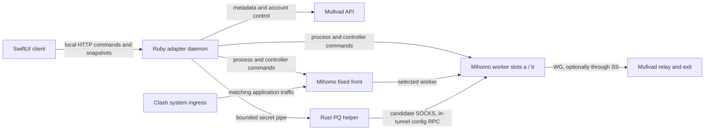

# Architecture

## Components

- `daemon/mullvad_adapter.rb`: long-lived local adapter. It owns metadata refresh and validation, relay selection, WireGuard/Shadowsocks worker lifecycle, front proxying, active health checks, bounded same-city recovery, event logging, and the HTTP control API. The front has no DIRECT fallback.
- `install-daemon.rb`: syntax/test gate, atomic installation, launchd restart, readiness and real HTTPS canary checks, and rollback.
- `verify-candidate.rb`: bounded candidate canary that exercises activation, real front HTTPS, rollback, and worker crash recovery without changing the production relay.
- `ui/Sources/MullvadAdapterUI`: SwiftUI app and menu-bar controls. `AdapterClient` talks to the local API; `AdapterViewModel` maps status/operations into UI state; `QuickPing` performs bounded ICMP checks using daemon-provided targets; diagnostic export redacts sensitive fields.
- `ui/Tests`: model, quick-ping, operation, and diagnostic redaction tests.
- `helpers/pq-negotiator`: bounded Rust process using a pinned official configuration client. It negotiates ephemeral PQ secrets through a candidate worker and does not own the operating-system network path.
- `.github/workflows/windows-shared-core.yml`: shared checks and optional unsigned Windows candidate.
- `.github/workflows/checks-and-candidate.yml`: Mac checks and arm64 candidate assembly; no signing, publish or deployment.

Mac components are synced from the 1.9.1/build13 source, not merely retained migration examples. Account-only first run, retained device drafts, explicit first identity install and main-window Dock presence are part of that implementation. Mac independent Clash-profile integration still has gaps documented in [mac-parity.md](mac-parity.md); its Windows counterpart is not evidence of Mac support. The [Mac maintenance entry](mac-development.md) separates source checks from installation and real egress.

## Current process and ownership map

Control and application traffic are separate. SwiftUI never carries application traffic. The Ruby daemon configures and observes the engines; it is not the WireGuard implementation. The outer Clash engine owns system TUN/rules/DNS. The adapter owns a fixed front and up to two worker slots. Two logical layers therefore do not mean exactly two engine processes. A normal single-hop worker has one WG tunnel; multihop deliberately adds a nested WG entry.

The source currently concentrates most backend responsibilities in one Ruby class and most UI orchestration in `AdapterViewModel`. Existing mutex/epoch/generation safeguards are substantive behavior, not portable scaffolding to discard. The principal Windows migration seams are:

| Responsibility | Current implementation | Portability boundary |
| --- | --- | --- |
| Cities, transport ranking, recovery, protection | Ruby daemon, controlled tests | Shared domain policy and attempt transactions |
| Metadata/account REST and canaries | Ruby HTTP/curl calls | Shared clients with explicit route, timeout and result evidence |
| Engine graph/front/slot ownership | Mihomo config and controllers | Engine backend, separate from OS ingress |
| Hardware attachment | macOS command output | Platform observer; local attachment is not Internet proof |
| Process lifecycle | POSIX spawn/signals/PIDs | Platform supervisor with instance tokens and bounded cleanup |
| Settings/secrets/logging | POSIX files, permissions, local paths | Platform paths, atomic storage and secret protection |
| UI/ping/report/clipboard/autostart | SwiftUI, Darwin APIs | Thin desktop client plus platform integration |
| Install/upgrade/rollback | Ruby tools and launchd | Platform installer and exact-artifact acceptance |

The legacy `mullvad-fail-open-watchdog` controls the official Mullvad app CLI, not this adapter. Its name does not describe the adapter front's routing policy. The local HTTP API rejects browser-origin mutations and requires the owner-readable capability for every POST. Account reads and secret requests also require that capability; ordinary diagnostic snapshots remain read-only. A new IPC implementation must explicitly authorize all control operations, rather than treating loopback binding as an authorization mechanism.

## Windows implementation and migration proposal

The Windows tree now implements an independent per-user Rust host (`core/crates/agent`), typed Tauri desktop (`desktop`), Mihomo front/workers and a physically bound SS UDP carrier, authorized local pipes, DPAPI storage, account/device management, and external Clash integration. It keeps the external-Clash ingress boundary. The macOS sections above describe the separate Ruby/Swift implementation, not Windows dependencies. Installation and egress acceptance belong to the exact candidate and target machine; code presence does not establish every feature or network environment.

Read the [Windows maintenance reference](windows-maintenance.md) for the implemented source map, runtime/build distinction and known transport/recovery limits. The [migration design](../openspec/changes/windows-shared-core/design.md), [requirements](../openspec/changes/windows-shared-core/specs/windows-recovery/spec.md), and [spec workflow](spec-development.md) retain original target contracts and historical PROPOSED/task states. They are not a current completion ledger. The common macOS backend handover and unsupported advanced Windows protections must not be inferred from the Windows host's existence.

The optional independent Clash profile path lives in `core/crates/clash-integration`
(`portable`, immutable policy and `profile_service`), with native import/readback in
`desktop/src-tauri/src/clash.rs` and the connection page in `desktop/src/clash-page.tsx`.
It owns no identity or tunnel and never writes the client's profile index. See the
[connection guide](clash-connect.md), [capability and provenance boundaries](network-capabilities.md),
and [portable profile requirements](../openspec/changes/clash-portable-profile/specs/portable-profile/spec.md).

## Data flow

1. The daemon refreshes relay metadata from the configured API/proxy, validates each relay, and persists a non-secret cache.
2. `/relays` exposes only the validated relay view plus daemon-derived `quick_ping` targets. The UI does not read the cache directly.
3. Clash sends matching traffic into the local adapter front. The daemon selects one active worker and keeps a bounded fallback/recovery path.
4. A quick check is ICMP-only, bounded by city/country scope. Full verification starts the selected transport and checks the actual proxy/HTTPS path.
5. Logs and diagnostic reports include layer, target, interface, timing, error, and reason while redacting secrets. The UI can export a copyable report.

## City workspace and recovery

`/cities` is the daemon-owned view of up to three favorite location IDs, the selected city, its current worker, and two ranked backup candidates. `POST /cities` atomically saves favorites; `POST /cities/select` returns an operation receipt and validates a same-city candidate before committing. Existing installations seed the workspace from the first committed relay; UI pins remain a separate browser preference. An explicit node selection changes the selected city and adds it to favorites, replacing the last favorite if all three slots are occupied.

Every automatic recovery entry uses the selected metadata location as a hard boundary, including startup retries when a saved node has disappeared. If there is no trustworthy city or no candidate, recovery remains disconnected rather than choosing another city. Explicit city/node selections can change this boundary.

Active and front data probes run outside the lifecycle mutex. Before applying observations, the daemon validates the generation, slot, relay, worker token/PID, and (for front probes) front PID. Busy commits retain a bounded-age observation and retry after 250 ms; they do not repeat the network probe or lose a complete polling cycle. Front/backend failures wake the health condition variable. The first complete failure receives a two-second recheck; repeated failures retain cooldown and common-DNS suppression.

Readiness validation keeps IP data, inner DNS, and domain HTTPS checks. Optional controller-delay diagnostics remain in full speed tests and do not delay activation or active-health validation. Automatic same-peer SS recovery tries one inlet, then up to two same-city candidates; the round stops starting new attempts after its 45-second budget. An already-running bounded probe may finish after that deadline. Lifecycle changes remain serialized and never create a second live worker for the same peer.

Candidate maintenance uses only outer ICMP probes: two candidates in the selected city every 30 seconds, other favorite cities every three minutes. Probe targets follow the expected transport. ICMP failure does not quarantine a relay; a recent complete success expires after ten minutes. These candidates are not connected hot standby tunnels. Logs bind activation queue/probe/commit events to attempt and recovery IDs, and distinguish passive recovery from relay, worker, or front replacement.

## Local attachment outages

A separate macOS observer checks hardware-interface link state and assigned addresses every two seconds. It ignores VPN/virtual interfaces and accepts either Wi-Fi or Ethernet, including usable IPv6. This proves local attachment only: it does not prove router WAN access, DNS, or relay health. Failed or incomplete observations report `unknown`; they cannot create an outage or release an existing outage latch.

When all observed hardware interfaces are disconnected or lack usable addresses, `/status.local_network` reports a pause and readiness becomes `waiting_network`. Automatic health recovery, dead-worker replacement, disconnected retries and candidate maintenance stop. Offline observations do not quarantine relays or write failed relay/SS histories. The fixed proxy front remains pointed at its worker; this state does not introduce a DIRECT fallback. Bounded probes already running may finish, but a network epoch invalidates their results and prevents committing a replacement.

After attachment remains available for two seconds, readiness becomes `network_recovering`. Recovery verifies the existing worker first. A live data path is preserved even when DNS or a test website remains degraded; normal DNS/service policy continues afterward. Otherwise recovery rebuilds the original relay, transport and SS inlet (and multihop entry where applicable). Only observed data-path failure, or the original relay being withdrawn from metadata, permits bounded same-city fallback. A busy slot or failed local construction defers recovery without quarantining relays. New fallback candidates and new PQ transactions still require full readiness. A repeated outage interrupts recovery; explicit user selection supersedes it. Busy commits reuse bounded-age probe evidence. Events record outage, link return, resume request, deferral and outcome; diagnostics skip remote tests while paused. UI keeps these messages in existing fixed-height regions and hides stale success/Ping evidence until verification completes. Actual Wi-Fi interruption, sleep/wake, long connections and production installation remain separate acceptance gates.

## Account boundary

Account/device management uses a separate gate and authenticated local `/account` endpoints. Official REST calls use the configured bootstrap proxy independently from the selected tunnel. Login validates before saving; the local public key identifies the current device. Clearing management login preserves the tunnel identity. Account credentials, capability files, access tokens and private-key responses never enter general snapshots, events or diagnostic exports. See `account-devices.md` for supported actions and official-daemon features outside this data path.

## Windows connection owner

The Windows host uses a persistent loopback front and one selected worker. Its
state owner sends bounded prepare/promote/verify/stop commands to an independent
I/O resource. A candidate's canaries, physically bound owned UDP socket, retained
Mihomo process and current operation/epoch must agree before durable path write,
selector change and final commit. A stopped candidate is reconciled before another
worker can reserve the same device identity. Startup path receipts are hints and
never restore traffic without fresh verification.

Initial city connection tries at most three nodes in that selected city. Recovery
of an established path retries the original path before bounded same-city fallback.
Local construction and queue failures defer the same target; measured negative
canaries and official withdrawal can advance it. Explicit relay selection cancels
older queued selections. Physical offline pauses scheduling; successful service
does not inherit an earlier recovery's expired budget. Original-path rebuild
re-authorizes the exact saved SS address and port against the current catalogue;
address ordering cannot silently choose a different inlet. Withdrawal advances
the recovery state instead of repeating a local invalid-path error. Network
waiting/unknown states clear displayed readiness. Attachment restoration or a
change of physical binding requests an immediate original-path check; binding
changes are logged even when attachment stays available. Explicit stop and front failure remain
visible throughout those network transitions. Typed diagnostic facts
record the target, SS inlet, physical interface and canary results without secret
configuration or raw engine output. See `windows-install.md` for package/runtime
boundaries; actual acceptance evidence belongs to the private context.

## Connection protection

`/protection` owns the committed protection policy separately from the effective worker. Nested WG outbounds implement multihop without an OS TUN; the existing SS/direct transport terminates at the independently selected entry city. Workers reserve entry and exit peers, and recovery keeps the exit city and protection policy. Changes validate and roll back the original profile; single-hop history does not prove multihop readiness. See `tunnel-protection.md` for protocol, capabilities and remaining engine dependencies.

## Runtime boundaries

The production daemon is installed under the user's local libexec/launchd locations and the app under `~/Applications`. Those runtime paths and private configuration are intentionally kept out of the public repository. A clean-room install and old-data migration require a real macOS acceptance run.

The single-hop PQ worker is a two-stage candidate transaction: bootstrap with the persistent device identity, negotiate through the in-tunnel SOCKS route using a packaged Rust helper, then rebuild with a fresh ephemeral private key and PSK. The persistent template is unchanged; transient key config is removed after core loading. Final readiness is required before front selection. A missing component or failed transaction never lowers a saved protection requirement. Installer acceptance binds both daemon and helper hashes.
