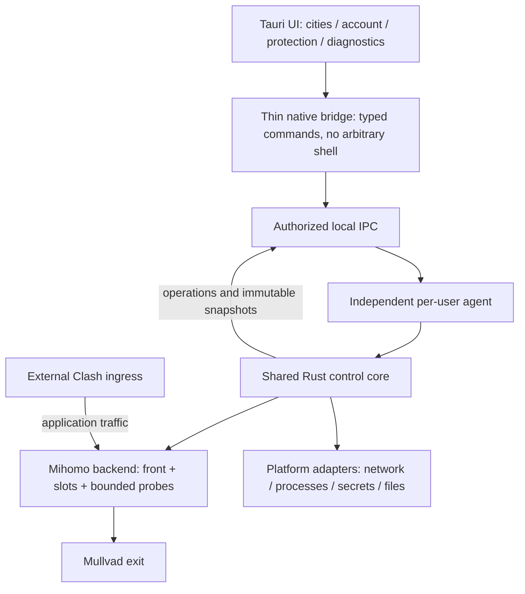

# Windows 迁移设计

Status: PROPOSED；这是维护 Agent 基于源码审查的推荐，框架原型、性能对比和 Windows 验收均未运行。基线源码 `a8e214ed4ba759b831dc096139f076114d13d91b`；当前实现结构以 [architecture.md](../../../docs/architecture.md) 为准。

## 1. 技术选型

推荐 Tauri 2 + React/TypeScript 薄界面、独立 Rust 后台、Mihomo backend。Rust 被选择用于统一事务状态、取消/代次和 Windows/macOS 系统边界，并可延续已有 Rust PQ helper 工具链；语言不会自动消除锁等待或网络失败。React 只负责页面和交互，不实现恢复决策。具体依赖版本在原型通过后锁定，不使用浮动 latest 构建。

| 方案 | 对本项目的收益 | 代价和结论 |
| --- | --- | --- |
| Tauri + Rust | 两端可共用界面和核心；本地资源；Windows 安装器、打包原生组件与受限调用入口 | SwiftUI 页面要重写，需 WebView2；推荐先 Windows、后 macOS UI，不承诺性能数字 |
| Avalonia + .NET | 跨平台 C#/XAML 自绘 UI；可自包含分发 .NET | 同样重写页面；若核心也用 C#，PQ Rust 仍是独立组件；有效备选，但项目目前没有 .NET 基础 |
| SwiftUI + Windows 原生 UI | 保留当前 macOS 体验，Windows 原生控件 | 两套 UI/状态映射长期维护；适合作为过渡，不复制业务后台 |
| Electron + Rust/Go | 成熟的 Web 桌面流程；官方 Mullvad 桌面也是 GUI/daemon 分离 | Chromium/Node 运行时和独立后台要同时维护；不是无效方案，暂不选择 |

不是“Rust 必然比 Go/C# 稳定”的结论；选择依据是本项目边界和现有组件。若 Windows 原型出现 WebView2、托盘或无障碍无法接受的问题，保持 IPC/core 不变，重评 UI；不因此重写恢复逻辑。

## 2. 目标结构与数据流



逻辑模块先共处一个 Rust workspace，避免拆多个仓库或微服务。目标目录尚未创建：

```text
core/crates/domain/              # 城市、证据、策略、恢复纯状态转换
core/crates/control/             # 唯一事务所有者、操作调度、共享 clients
core/crates/engine-mihomo/       # 图配置、controller、front/worker、canary
core/crates/platform/            # 平台接口与 win32 / macOS 实现
core/crates/protocol/            # 类型、协议版本、脱敏 fixture
core/crates/agent/               # 无界面后台、日志/持久化/IPC host
desktop/                        # React/TS + Tauri 薄 bridge
packaging/windows/              # 安装/升级/回退、清单和平台检查
helpers/pq-negotiator/           # 已有受控独立 helper
```

domain 不依赖 Tauri、Win32、shell 或网络。control 不导入 UI；engine 不决定跨城策略。共享核心包含 metadata/account clients、probe evidence、history/log export；平台层只处理接口、路径、权限与进程。不会把五千行 Ruby 原样翻译到一个 Rust 文件。

首版沿用 front + 双槽事务图；新增后台不是新增隧道层。Mihomo 是实际 WG/SS 数据面，Rust 后台是控制者。以后若要去掉外层 Clash或合并 front，另做路由/DNS/规则/排空/泄漏规格及验收；仅迁移 UI 不会减少当前数据面层数。

## 3. 并发、网络和操作合同

恢复改为由一个状态所有者接收事件；耗时网络、helper、磁盘和进程等待在有界任务执行器中进行，完成事件再短提交。状态所有者不能等待 canary 或杀进程；串行的是生命周期决策，不是所有 I/O。用户操作、网络断开和停机有优先级；metadata/ICMP 队列合并重复任务，队列/并发/超时设上限。

ProbeContext 至少绑定 `agent_boot_id`、generation、network_epoch、operation/attempt ID、slot、instance token、front token。PID 只是诊断字段；Windows 可复用 PID，不以 PID 单独确认所有权。结果不匹配则丢弃，不写 relay 失败史。健康判断提交忙时复用未过期观察；一个 peer 不允许第二 live 实例；PQ bootstrap→协商→最终 worker 持有同一 peer 预留。

先按既有 baseline 行为移植，保留正常间隔/首次复检/预算/TTL；随后根据事件计时优化，不先承诺“秒切”。本机接入观察事件触发 + 定期复核；unknown 与 WAN/DNS 故障分开。新核心接收 raw physical evidence 后按共同规则判断，不能使用 Windows 的一个“Internet unavailable”标志直接切节点。用户手动选择应优先于旧恢复，但不能绕过保护或代次校验。

## 4. IPC 与客户端

目标 Windows 使用带显式 DACL 的本地 Named Pipe；macOS 使用 owner-only Unix domain socket。所有读写检查允许用户/连接身份，所有控制操作授权；敏感读取额外显式请求。拒绝远端 pipe、未经授权会话、超限 payload 和版本不兼容。Windows 默认 pipe ACL 不能照搬。

初始选型是有界长度帧的 JSON 消息，统一从 protocol 类型生成 TS 类型；尚未实现或发布 schema。连接先握手协商 API major/minor、backend build、capabilities、boot ID。快照有 sequence/generation/epoch；事件只负责及时唤醒，掉线重连必须重新取完整快照。命令用 request ID 幂等地接受并返回 operation ID；UI 重连后查同一操作，不能重复发兑换/撤销/切换。缓存幂等结果必须有容量/TTL，不把账号秘密写进日志。

SwiftUI 过渡可使用 loopback HTTP compatibility adapter，仅映射受版本约束的旧接口，secret/control仍须授权。恢复来源只有一个后台，不能 Ruby 与 Rust 同时主动管理生产 front/peer。先制作脱敏合同 fixture 与行为回放，再移交管理权。旧客户端不能理解的保护能力需明确显示 unsupported。

Tauri bridge 只开放项目类型化调用、报告路径复制、通知/托盘等必要命令；不向 renderer 开通通用 shell/任意文件访问，不加载远程 UI。不把 Tauri capability 当作后台 pipe 的身份校验；两边独立执行检查。

## 5. Windows 平台和生命周期

首版范围是“当前登录用户的 Clash 适配器”。独立 agent 以同一普通用户运行；安装器提供受控登录启动/崩溃恢复入口（优先评估任务计划程序）。UI 关闭/崩溃不停止 agent。显式“退出界面”“停止代理后台”“退出账号管理”分别处理，停止影响必须说明。首版不保证无人登录时运行。

| macOS 耦合 | Windows 实现方向与需验收的问题 |
| --- | --- |
| networksetup / ifconfig | IP Helper 全量快照 + NotifyIpInterfaceChange / 地址通知；物理、虚拟、Wi-Fi、有线、IPv6和多网卡按 LUID/类型证据分类，回调只入队，重读完整数据 |
| POSIX spawn / TERM / waitpid | CreateProcess/Job Object；归属 agent 的子进程树，bounded shutdown与handles；UI退出不能关闭此 job |
| launchd | 用户 agent 的启动/恢复与单实例；后续 OS TUN阶段才评估 SCM 和最小特权 helper |
| POSIX 0600 / fsync + rename | 用户 SID ACL、DPAPI用户域加密、Windows原子替换与落盘错误；文件占用/杀毒拦截也需处理 |
| app/default paths | agent-owned用户数据目录与明示路径发现；不读取 Clash App 私有安装布局 |
| SwiftUI QuickPing | 由后台提供目标/传输语义；Windows ICMP API，按城市有界队列；ping不证明WG和服务可用 |
| AppKit剪贴板/报告 | 后台生成脱敏报告、UI复制路径/打开目录；报告不含 account/key/helper秘密 |

DPAPI 与用户身份绑定，不能把后台直接改成 SYSTEM 后继续读用户的加密数据。若未来系统级隧道要求特权，新增小的 SCM helper，只接受受限网络操作，明确用户/服务密钥和 ACL 迁移；普通 UI、账号管理和全局命令不因此获得管理员权限。关闭后台后仍存在的外部 Clash 路由不由本变更擅自改写；首版不能承诺全机 kill-switch，只保证 adapter 路径没有 DIRECT 回落。

## 6. 打包和功能范围

优先 Windows 11 x64；Windows 10 支持的具体版本和 ARM64 是待确认/待验证范围，不凭框架支持列表宣布本项目兼容。Windows runner 本机构建，检查 PE 架构和 helper依赖，避免只从 macOS 交叉编译得出安装结论。

安装候选包括 UI、独立 agent、固定 Mihomo、支持的 helper、许可证/依赖清单、完整 source SHA/版本/大小/SHA256/签名状态。用户不装 Rust/Node/Ruby/protoc。WebView2 必须检测并由安装器处理；网络工具不能把“缺 WebView2 时必须先联网下载安装”作为唯一恢复入口，优先评估带 offlineInstaller 的完整包，另测系统已有 runtime 的安装路径。代价是包更大，不能拿 Tauri最小示例体积估算本项目完整包。

首个骨架不宣称连接可用；第一个可用 beta 要覆盖城市、WG/SS、恢复、ICMP/完整验证、诊断、账号管理和普通多跳。单跳PQ必须 Windows helper编译和真实隔离 canary通过才作为 capability交付；未通过时不得接收既有必需PQ策略并静默降级。多跳+PQ、DAITA、其他载体继续 explicit unsupported，另立变更。GPL组件保持独立来源/版本/许可证及相应源码可取得性，分发审查是 publish前门禁。

升级事务先验摘要/协议/存储版本、保存明示回滚点，再停止旧后台并切换新产物；失败恢复原产物与兼容配置。旧数据损坏不能自动删除；秘密导入仅显式本机事务，不上传到CI。装包、启动、交互、路由、旧数据升级、断网、睡眠、多网卡、长连接各有真实验收，见tasks。

## 7. 实施顺序与取舍

P0冻结合同/fixture → P1纯domain与mock Windows后台/IPC/安装骨架 → P2引擎backend与完整恢复 → P3城市/账号/保护/报告UI和功能对齐 → P4真实Windows候选验收 → P5经授权再移交macOS后台，最后评估共用UI。每阶段能独立失败/回退；不同时换UI、业务、引擎和OS ingress。Ruby是行为参照，停止双后台写入前先通过差分回放。

阻塞点优先测：独立agent退出/崩溃行为、pipe ACL和用户密钥、Mihomo/WG/SSWindows实际出站路径、PQ helper上游编译、断网/睡眠观察、WebView2离线安装。不能只做漂亮页面再补这些。

## 官方资料与推断边界

- [Tauri架构与系统WebView](https://v2.tauri.app/start/)、[capabilities](https://v2.tauri.app/security/capabilities/)、[原生组件打包](https://v2.tauri.app/develop/sidecar/)、[Windows安装与WebView2](https://v2.tauri.app/distribute/windows-installer/)：打包能力不等于独立后台生命周期已实现。
- [Avalonia](https://docs.avaloniaui.net/docs/welcome)、[.NET自包含发布](https://learn.microsoft.com/en-us/dotnet/core/deploying/)、[Electron进程模型](https://www.electronjs.org/docs/latest/tutorial/process-model)：备选架构事实；资源/稳定性未做本项目基准测试。
- [官方Mullvad结构](https://github.com/mullvad/mullvadvpn-app#readme)：参考其UI/daemon/平台边界，不能推导本项目Mihomo具备全部官方数据面能力。
- [接口变化通知](https://learn.microsoft.com/en-us/windows/win32/api/netioapi/nf-netioapi-notifyipinterfacechange)、[Named Pipe权限](https://learn.microsoft.com/en-us/windows/win32/ipc/named-pipe-security-and-access-rights)、[DPAPI](https://learn.microsoft.com/en-us/windows/win32/api/dpapi/nf-dpapi-cryptprotectdata)、[Job Objects](https://learn.microsoft.com/en-us/windows/win32/procthread/job-objects)：提供OS机制，实际组合与适配器分类尚需实现验收。
